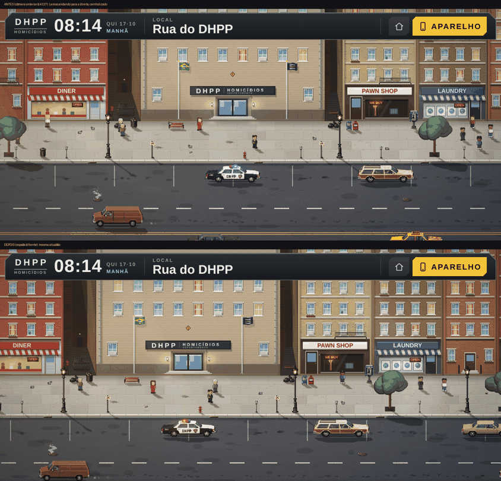

# Sistema de direção de câmera

Implementação de outubro de 2026 para Rua do DHPP, interior da base, Varredura da Rua das Acácias e depoimentos ilustrados. A câmera continua integrada aos renderizadores existentes; não existe um segundo canvas, uma projeção paralela nem uma dependência gráfica nova.

## Diagnóstico inicial

### Rua do DHPP

- A projeção Beat Cop e a escala inteira já estavam corretas, mas o acompanhamento usava um `lerp` fixo por quadro e mantinha Lemos perto do centro.
- Não havia dead zone, look-ahead, controle manual, zoom próprio nem composição específica para a fachada do DHPP.
- A resposta mudava com o FPS e a rua ignorava gestos de câmera que já existiam no interior.
- A composição vertical era boa no enquadramento padrão, mas não reagia à aproximação da entrada nem ao sentido do deslocamento.

### Espaço à frente (rua, base e casa)

Corrigido na validação em navegador (ver abaixo). A primeira versão usava uma zona morta (219 px) maior que o look-ahead (125 px): a câmera ficava *atrás* de quem andava e Lemos ocupava a metade da frente da tela, deixando menos espaço à frente do que a câmera anterior.

`createLead` resolve isso separando as duas ideias:

- o **espaço à frente** é um deslocamento do alvo, suavizado, na direção em que o personagem anda;
- ele cresce e inverte no máximo a ~100 px de mundo por segundo (a caminhada de Lemos), então inverter o sentido leva alguns segundos calmos em vez de uma chicotada;
- ao parar, a câmera **guarda cerca de um terço** do espaço (na direção em que ele olha) em vez de voltar ao centro: a composição fica estável e não parece estar "procurando";
- a **zona morta** vira só histerese, para ignorar micro-movimentos;
- com redução de movimento, o espaço à frente é zero.

### Interior do DHPP

- Pinça, arrasto, toque duplo, âncora do zoom e limites já existiam e foram preservados.
- O acompanhamento apontava diretamente para Lemos ou para o interlocutor, com a mesma regra em todas as salas.
- O `lerp` já era temporal, mas não havia dead zone, antecipação de caminho, estabilização ao parar, perfis por cômodo nem carência depois do controle manual.
- As conversas aproximavam a câmera, porém o foco e o acompanhamento não possuíam uma política explícita de prioridade.

### Casa da Rua das Acácias

- A cena já tinha visão geral, zoom de pixel, pinça ancorada, arrasto, limites, seleção de agentes e foco de ocorrências.
- O acompanhamento puxava o agente selecionado diretamente para o centro, sem considerar caminho, cômodo ou tempo desde o gesto manual.
- O foco de uma ocorrência e o acompanhamento normal podiam disputar a mesma posição.
- A planta já separava camadas, ordenava sprites pelo pé e fazia culling; esses sistemas foram preservados.

### Interrogatórios e retratos

- `portraitRenderer.ts` já limita e alinha a arte oficial, compõe expressões e desativa deriva/tremor em redução de movimento.
- A sala aplicava um balanço contínuo de câmera. O efeito chamava atenção mesmo sem ação narrativa e podia causar desconforto.
- O foco entre rosto, legenda e caderno já era orientado pela fase; faltava usar a própria fase como motivo do reenquadramento.

### Interface do celular e pós-processamento

- O Invesphone é uma interface, não um mundo navegável. Ele mantém viewport estável e não recebe pan, parallax ou follow artificial.
- `src/base/post.js` continua responsável apenas pelos passes visuais opcionais. A política de câmera permanece no Canvas 2D para não introduzir leituras de quadro nem custo extra no Safari.

## Arquitetura

`src/camera/cameraDirector.js` reúne somente a política compartilhada:

- prioridades de controle;
- carência do controle manual;
- foco temporário e interrupção;
- cálculo de dead zone (como histerese) e do **espaço à frente** (`createLead`);
- damping exponencial independente do FPS;
- overlay de diagnóstico.

Cada cena continua dona de sua geometria, projeção, limites, zoom e conversão entre tela e mundo. Essa divisão evita quebrar a perspectiva oblíqua da base/casa ou a projeção frontal da rua.

## Prioridades

Da maior para a menor:

| Prioridade | Uso |
|---|---|
| `narrative` | Evento narrativo obrigatório e não interrompível |
| `critical` | Entrada, saída e interação crítica |
| `context` | Foco solicitado ou acontecimento contextual |
| `manual` | Arrasto, pinça, roda e zoom do jogador |
| `follow` | Acompanhamento normal do personagem |
| `ambient` | Ajuste ambiental discreto |

Um foco acima de `manual` só bloqueia o gesto se declarar `interruptible: false`. Focos contextuais usados hoje são interrompíveis. O controle manual mantém a câmera por 2,6 s na rua/base e 2,8 s na casa; o follow só retorna depois dessa janela ou quando o jogador escolhe explicitamente um novo alvo.

## Perfis por ambiente

### Rua

- Mantém fachadas frontais, calçada vista de cima, rua horizontal e carros laterais.
- Escala final sempre inteira; `imageSmoothingEnabled` continua desligado.
- Dead zone pequena (4% da largura e 10% da altura visíveis), só como histerese.
- Espaço à frente (`createLead`): o centro da câmera fica adiante de Lemos, até 14% da largura visível (no máximo 230 px de mundo).
- Ao se aproximar intencionalmente da porta, enquadra Lemos e DHPP juntos e sobe discretamente o centro para valorizar a fachada.
- Ao parar, retorna devagar a uma composição estável, sem oscilação.
- Pinça, roda, arrasto e toque duplo usam zoom próprio entre 1× e 2,75× e preservam o ponto sob o gesto.
- Nos extremos, o clamp mantém o quadro dentro do quarteirão; quando o viewport é maior que o mundo, centraliza o eixo em vez de gerar área inválida.

### Interior do DHPP

Perfis em `CAMERA_ROOMS` ajustam a histerese (dead zone, aplicada a 40% na horizontal e 70% na vertical), o viés e a atração pelo centro arquitetônico:

| Área | Direção |
|---|---|
| Sala da delegada | Plano menor, levemente deslocado para preservar mesa e interlocução |
| Equipe | Dead zone mais larga e pouca atração, adequada à circulação entre mesas |
| Perícia | Plano compacto que mantém bancada e personagem legíveis |
| Interrogatório | Composição estável e fechada, com espaço para o cartão de conversa |
| Hall | Plano mais aberto para portas e circulação |
| Arquivo | Plano compacto para estantes e objeto interativo |
| Exterior/paredes | Dead zone mais permissiva, sem atração artificial por cômodo |

O próximo tile da rota determina o look-ahead. Quando Lemos para, a recentralização começa após 550 ms e permanece parcial para evitar que a câmera “procure” o centro. Conversas podem focalizar interlocutor/objeto sem apagar o enquadramento do cartão.

### Casa

- A visão geral existente (`FITZ`) continua sendo a referência espacial e os limites incluem terreno e margens úteis.
- O agente selecionado usa o espaço à frente (até 10% da largura visível), histerese pequena e leve atração pelo cômodo atual.
- Em zoom de detalhe, a atração pelo cômodo cresce para manter móveis e objeto investigado no mesmo contexto.
- Arrasto, pinça, roda e toque duplo suspendem o acompanhamento. Selecionar novamente um agente retoma o follow de forma explícita.
- `panTo` de uma ocorrência recebe prioridade contextual e não concorre com o follow durante o foco.
- A seleção, a câmera e o zoom existentes não entram no save; a progressão investigativa permanece inalterada.

### Interrogatórios

- O plano deixou de balançar continuamente.
- Escolha da pergunta abre discretamente o quadro para o caderno.
- Pergunta aproxima 0,8%; resposta aproxima 2,2%; pressão alta permite no máximo 3,5%.
- O ponto de transformação fica na região superior central, preservando rosto, expressão, legenda e mesa.
- A transição usa easing amortecido e só ocorre quando a fase muda.
- Com redução de movimento, não há reenquadramento, transição, respiração, deriva ou tremor.

### Celular de Lemos

- Não recebe câmera de mundo. Navegação, documentos e fotografias preservam a natureza de interface.
- A passagem rua/base ↔ aparelho continua pelas transições curtas existentes, sem pan ou zoom que altere coordenadas de toque.

## Zoom e coordenadas

- Base e casa preservam os limites e o snapping existentes.
- Rua ganhou zoom ancorado: antes de trocar a escala, o sistema calcula o ponto de mundo sob o centro do gesto e recompõe a câmera para mantê-lo no mesmo ponto da tela.
- A rua quantiza a escala final para inteiro. Casa/base quantizam pelo DPR existente, evitando pixels irregulares sem impedir níveis úteis em telas Retina.
- Toda conversão usa as funções existentes `PX/PY`, `s2w` e o fator de rotação atual. O controlador compartilhado não interpreta coordenadas de toque.
- Mudanças de orientação passam por `resize`, recalculam a área útil e reaplicam clamps da cena.

## Eventos e transições

Os eventos implementados são intencionais e curtos:

- retorno à rua: plano de estabelecimento de 480 ms;
- chegada/entrada no DHPP: enquadramento conjunto de Lemos e fachada;
- entrada no interior: foco de transição de 420 ms;
- abertura de conversa: foco no interlocutor/objeto;
- ocorrência da casa: foco contextual de 650 ms;
- fases do interrogatório: reenquadramento CSS de 720 ms.

Não há zoom automático em interação comum, balanço permanente, camera shake global ou revelação antecipada de ponto investigativo.

## Mobile, HUD e áreas úteis

- Base e rua continuam usando a rotação artificial existente; a transformação dos gestos passa por `PX/PY` antes de chegar à câmera.
- A casa mantém `HUDPAD` no clamp para descontar cabeçalho e dock, em vez de usar o centro geométrico bruto.
- Conversas em paisagem deslocam o alvo horizontalmente; em retrato, verticalmente, deixando espaço para o cartão.
- Dead zones são proporcionais ao viewport e, portanto, não pressupõem uma única proporção.
- Os limites tratam viewport maior que o mundo, condição importante em 844×390, 390×844 e 375×667 após rotação/DPR.

## Acessibilidade

`prefers-reduced-motion: reduce`:

- amplia a dead zone;
- remove look-ahead;
- encurta focos automáticos para no máximo 160 ms;
- elimina o reenquadramento da sala de interrogatório;
- preserva pinça, arrasto, seleção, zoom e legibilidade;
- não adiciona tremor nem movimento respiratório global.

## Diagnóstico

Acrescente `?cameraDebug=1` à URL da base ou da casa. O overlay mostra:

- cena/cômodo;
- modo e prioridade ativos;
- posição e zoom;
- dead zone;
- alvo efetivo.

Os painéis `?debug=1` e de desempenho existentes continuam independentes. `window.__base` e `window.__acacias` continuam disponíveis para inspeção durante desenvolvimento.

## Desempenho

- O damping é O(1) por quadro e usa `dt`.
- Não foram adicionados canvases auxiliares, matrizes, leituras de pixels ou estados React por quadro.
- Culling, listas de desenho, ordenação por profundidade, camadas e pós-processamento existentes foram preservados.
- O overlay só desenha quando `cameraDebug=1`.

## Validação em navegador (outubro de 2026)

A primeira entrega foi feita sem navegador. Esta rodada usou o Chromium com Playwright (CPU normal, DPR 2) e os mesmos roteiros na revisão anterior à reformulação (`7fdbbda`, build separado) e na atual. Todas as medições são de jogo rodando, não de imagens estáticas.

### Rua: Lemos anda pelo quarteirão

Medido em quadros em que a câmera não está no limite do mapa, com o mesmo roteiro e o mesmo método nas três revisões. "Espaço à frente" é a fração da largura da tela que fica à frente de Lemos (0,50 = centralizado; maior é melhor).

| Situação | Antes da reformulação | Primeira versão (#227) | Atual |
|---|---|---|---|
| 844×390, andando para a direita | 0,49 | 0,42 | **0,57** |
| 844×390, andando para a esquerda | 0,49 | 0,43 | **0,59** |
| 375×667, andando para a direita | 0,49 | 0,44 | **0,57** |
| 375×667, andando para a esquerda | 0,49 | 0,45 | **0,59** |
| Oscilação de Lemos na tela, 844×390 (px por quadro, normalizada pelo tempo; direita / esquerda) | 0,32 / 0,30 | 0,14 / 0,11 | 0,15 / 0,13 |
| Oscilação de Lemos na tela, 375×667 (direita / esquerda) | 0,05 / 0,08 | 0,05 / 0,05 | 0,07 / 0,04 |
| Posição de repouso de Lemos ao parar (esquerda, 844×390) | 0,50 | 0,43 | 0,53 |
| Inversões da câmera ao parar | 0 | 0 | 0 (1 em 375×667, esquerda) |

A reformulação da #227 já suavizava o movimento (oscilação menor que a câmera anterior em 844×390), mas deixava Lemos *à frente* do centro: menos espaço no sentido da caminhada do que antes. O espaço à frente (`createLead`) inverte isso sem perder a suavidade.

Ao inverter o sentido de caminhada, Lemos oscila entre 40% e 57% da largura (antes: 49% a 51%). A velocidade da câmera chega a cerca de 180 px/s (a de Lemos é 96 px/s) por no máximo dois segundos, e depois cai. Em um quadro isolado, ao sair do limite do mapa, ela passa de 360 px/s.

### Gestos na rua, nos três tamanhos (inclusive a rotação artificial em retrato)

| Teste | 844×390 | 390×844 | 375×667 |
|---|---|---|---|
| Arrastar 160 px na tela: deslocamento do mundo (esperado 320 px) | 320 | 320 | 320 |
| Retorno ao acompanhamento começa após | 2,58 s | 2,56 s | 2,57 s |
| Velocidade máxima do retorno | 136 px/s | 138 px/s | 94 px/s |
| Zoom da roda: escala antes → depois | 1 → 2 | 1 → 2 | 1 → 2 |
| Deriva do ponto sob o cursor | 3,8 px | 3,8 px | 2,9 px |
| Escala sempre inteira | sim | sim | sim |
| Escala mínima / máxima | 1 / 3 | 1 / 3 | 1 / 3 |
| Área vazia na tela com zoom mínimo | 0 | 0 | 0 |

### Interior do DHPP: percurso por todos os cômodos

Hall → equipe → perícia → sala da delegada → interrogatório → arquivo → hall. Em 844×390 (os outros tamanhos usam a mesma tela lógica, rotacionada):

- distância mínima de Lemos às bordas da tela: 107 px;
- nenhum quadro com Lemos sob o cabeçalho;
- área vazia na tela de no máximo 17% (só nos cômodos que ficam nas extremidades do mapa);
- fora do centro apenas onde o limite do mapa impede centralizar (perícia, delegada, interrogatório e arquivo);
- resultados iguais antes e depois do espaço à frente.

### Casa
Visão geral e agente selecionado andando até a casa em 844×390, sem erros; o agente permanece dentro da tela (de 25% a 39% da largura; antes, de 32% a 51%).

### Interrogatório (Lívia)
Nos três tamanhos:

- parado, o plano não se mexe (transformação identidade);
- escolher → perguntar → responder passa por três planos distintos, com escala de 0,992 a 1,022 e transição suave;
- o rosto permanece inteiro na tela (menor margem de 16 px);
- nenhum erro de script.

### Fluxo rua → DHPP → rua
Passa nos três tamanhos, sem erros.

## Testes realizados

- `node tools/camera-system-test.mjs`: 17 verificações de dead zone, espaço à frente (crescimento, inversão limitada e repouso), equivalência a 30/60 FPS, carência manual, prioridade narrativa, interrupção contextual e redução de movimento.
- `node --check`: controlador, rua, base e casa.
- `git diff --check`.
- `npm run build`: TypeScript, Vite e geração do PWA aprovados.

O que ainda **não** foi validado:

- Safari/iPhone reais (pinça de dois dedos, notch/Dynamic Island, retorno do segundo plano). A pinça foi coberta pela lógica compartilhada e pelo zoom da roda, mas não com dois dedos de verdade.
- `tools/e2e/screens-fit.mjs` não foi executado nesta rodada.
- Vídeo da câmera em movimento: as medições acima são séries quadro a quadro, mas não houve gravação.

## Comparação funcional

| Antes | Depois |
|---|---|
| Personagem sempre no centro | Espaço à frente suavizado (0,57–0,59 da tela à frente, contra 0,49) |
| `lerp` da rua dependente de quadros | Damping temporal estável |
| Mesma composição em todas as salas | Perfis por cômodo e atração arquitetônica moderada |
| Gesto manual perdido assim que o follow voltava | Carência explícita e retorno previsível |
| Rua sem câmera manual/zoom | Pan, pinça, roda, toque duplo e âncora |
| Casa centralizava o agente | Cômodo, rota e visão geral participam do quadro |
| Balanço contínuo no interrogatório | Mudanças curtas motivadas por pergunta/resposta |
| Prioridades implícitas | Política compartilhada e depurável |

A comparação com capturas do mesmo enquadramento está em `docs/img/camera-rua-antes-depois.png` (rua, Lemos andando para a direita; revisão anterior à reformulação contra a atual).

## Problemas conhecidos e próximos passos

- Validar pinça de dois dedos, safe areas, notch/Dynamic Island e retorno de segundo plano em Safari real.
- Executar `screens-fit.mjs`.
- Gravar um vídeo curto caminhando nos dois sentidos.
- A deriva do ponto sob o cursor no zoom da roda (até 3,8 px) vem de arredondar a escala para inteiro; dá para zerar recalculando o ponto de ancoragem com a escala final.
- Medir conforto e legibilidade em movimento com pessoas reais; ajustar somente constantes de perfil, sem trocar a perspectiva aprovada.
- Eventos narrativos futuros podem usar `narrative` não interrompível, mas devem oferecer avanço/skip quando durarem além de uma transição curta.
