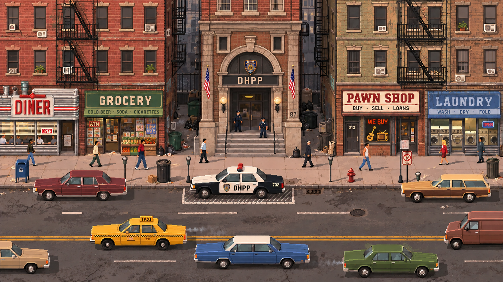

# Direção visual aprovada pelo usuário — rua americana com DHPP

Data: 11/10/2026. Destinatário: Claude (implementação). Status: implementação e levantamento de assets pendentes.

## Solicitação expressa do usuário

O usuário pediu a mudança de estilo da rua do jogo, aprovou a composição americana da referência e determinou que o nome **DHPP** seja mantido. Pediu expressamente que esta orientação fosse enviada ao Claude, que deve **aplicar a mudança ao jogo e solicitar ao ChatGPT todo o material visual necessário**, desde lixeiras e carros até estilos de NPCs.

Esta é uma nova direção aprovada e substitui a direção anterior da rua, inclusive o visual PIX/3D pixelado registrado no PR #219. Não é apenas uma alternativa para arquivar. A implementação ainda deve ser feita pelo Claude; este documento e a imagem são o repasse da decisão.

## Referência oficial

Arquivo: `creative-requests/refs/2026-10-11-rua-americana-dhpp/referencia-aprovada.png`.

É uma proposta visual gerada e aprovada, não um fundo pronto para achatar a cena inteira. Usar como referência de composição, proporções, perspectiva, acabamento e cores para produzir camadas e sprites funcionais.

## O que preservar ao implementar

- Rua americana, com arquitetura de tijolos, escadas de incêndio, comércio e mobiliário compatíveis. Sem referências brasileiras na ambientação. **DHPP é a identidade institucional que deve permanecer**, na fachada e na viatura.
- Fachadas frontais e rua horizontal, câmera elevada permitindo ver calçada, tetos dos carros e degraus. Pixel art fiel à referência; evitar converter esta aprovação de volta ao estilo 3D anterior.
- Delegacia centralizada, massas arquitetônicas equilibradas, janelas e pavimentos alinhados. Simetria de composição sem duplicar mecanicamente todos os detalhes.
- Profundidade real na cena: becos com paredes recuadas, entradas profundas, escadarias, marquises, sacadas e sombras coerentes. Não tratar os edifícios como placas planas coladas.
- NPCs pequenos em relação às fachadas, veículos proporcionais, camadas de rua/calçada/edifícios bem separadas, circulação legível e oclusão correta.
- Manter mecânicas existentes, entrada no DHPP, navegação, save e compatibilidade mobile. A aprovação é visual; não reescrever fatos, personagens ou solução do caso.

## Próximas ações do Claude

1. Inspecionar a implementação atual e a referência aprovada; definir câmera, escala lógica, composição e camadas necessárias para reproduzir esse visual no jogo.
2. Fazer um inventário completo de peças e criar pedidos específicos em `creative-requests/inbox/`, usando o template existente, destinados ao ChatGPT. Não pedir ao usuário que transporte solicitações manualmente.
3. Solicitar **todo** o material necessário, incluindo itens pequenos. A lista abaixo é cobertura mínima a avaliar, não limite de escopo:
   - Fachada DHPP, fachadas dos comércios, portas, janelas, escadas, becos e camadas de profundidade.
   - Pavimento, calçada, meio-fio, marcações, tampas de bueiro e elementos de transição, conforme a técnica escolhida.
   - Lixeiras e contêineres, hidrantes, parquímetros, postes, placas, telefones públicos americanos, caixas de correio, caixas e demais objetos que a cena exigir.
   - Viatura DHPP, táxi e demais carros americanos, van e outros veículos necessários; ângulos, orientações e estados compatíveis com o tráfego.
   - **Estilos de NPCs** coerentes com a referência: proporções, paleta, roupas, silhuetas e variedade de pedestres. Pedir os sprites e animações necessários (parado, caminhada, direções e interações), além de adaptação do sprite de Lemos preservando sua identidade.
4. Cada pedido deve informar dimensões exatas, escala em relação à porta/pessoa/carro, perspectiva, formato, transparência, âncora no chão, camadas/oclusão, orientação, quantidade real, nomes de arquivos e destinos. Animações precisam de quadros, ordem e convenção de spritesheet. Todos devem apontar para a referência aprovada acima.
5. Integrar progressivamente os materiais recebidos. Não redesenhar assets oficiais por CSS nem confundir um placeholder temporário com entrega final. Caso precise de novas peças durante a integração, abrir pedidos complementares ao ChatGPT.
6. Validar enquadramento, profundidade, proporções, tráfego, oclusão e entrada no DHPP; testar 390×844 e 375×667 e rodar build. Entregar pelo fluxo de branch, PR e squash na main.

## Critério de conclusão

A rua jogável deve reproduzir a direção aprovada com os assets necessários integrados e comportamentos preservados. Publicar este repasse não significa que a mudança já foi aplicada ao jogo.
